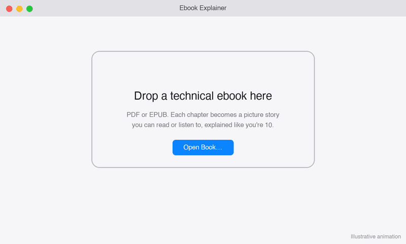

# 📚 Ebook Explainer (macOS)

[](LICENSE) [](#) [](CONTRIBUTING.md) [](https://github.com/rajumuke-dev/ebook-explainer)

Drop in any technical ebook (PDF or EPUB). Each chapter becomes a story explained as if you were 10: fun analogies, cartoon pictures, a real-life example, a recap and a quiz. You can **read** it, **listen** to it, or do both.

It follows the "upload a source, get a guided overview" pattern of apps like NotebookLM (audio overviews), ChatPDF and Blinkist, adapted for kids-level explanations.

<div align="center">



<sub>Illustrative animation of the main flow (not a screen recording).</sub>

</div>

## Modes
| Mode | What happens |
|---|---|
| **Listen** | Narrated slideshow: a big picture plus subtitles, auto-advancing. No reading needed. Space = play/pause. |
| **Read** | Scrollable picture cards and a quiz. |
| **Read + Listen** | Cards are narrated and auto-scroll, with the current card highlighted. |

## Run
```bash
./build-app.sh                       # builds "build/Ebook Explainer.app"
open "build/Ebook Explainer.app"
```
It works straight away on the **free provider** ([Pollinations.ai](https://pollinations.ai), no key or signup needed):
- It allows about one lesson and one picture every 45 seconds per network, and is sometimes busy. The app waits and retries automatically, and shows emoji until each picture arrives.
- The free female Mac voice does the narration. Switch to the OpenAI voice from the player bar if you have a key.

For faster pictures and a more natural voice, open **Settings (⌘,)**, switch to **OpenAI** and paste your key. It is stored in the macOS Keychain, or you can launch with `OPENAI_API_KEY` set in the environment.

> The free OpenCode Zen models can't be used here: without an OpenCode Zen key the service refuses the request and says free models only work inside the OpenCode app.

## How it works
- **Chapters:** taken from the PDF outline (table of contents). Without one, the book is split into 15-page chunks. EPUBs follow their reading order (spine). Scanned, image-only PDFs aren't supported.
- **Web references:** before writing a lesson, the app looks up the chapter topic on Simple English Wikipedia (written for young readers) and Wikipedia. This is free and needs no key. The summaries go into the prompt for accurate background, easier wording and a **"🤓 Did you know?"** slide. Lessons end with **"📚 Learn more online"** links. If the lookup fails, the lesson is still created.
- **Lesson:** a structured JSON lesson. Free: Pollinations' `openai` model, with up to 20k characters of chapter text. OpenAI: `gpt-4o-mini`, with up to 60k characters.
- **Pictures:** one per step, drawn one at a time. Free: Pollinations images. OpenAI: `gpt-image-1`.
- **Voice:** female in both engines. Switch with the **Voice** menu in the player bar: **Mac voice (free)** uses the best installed female English voice (e.g. Samantha); **OpenAI voice (natural)** uses `gpt-4o-mini-tts` "coral" and needs an API key. It falls back to the Mac voice if that fails.
- **Cache:** lessons and pictures are saved in `~/Library/Application Support/EbookExplainer/<book-hash>/`, so reopening a chapter is free.

**Privacy:** chapter text is sent to the selected AI provider, and chapter titles to Wikipedia. Don't use the free provider for confidential books.

## Tests
`Tests/` uses XCTest. Run it with `swift test`, which requires a full Xcode install because the Command Line Tools don't include XCTest or the SwiftUI and Testing macro plugins. For the same reason the app uses a small `ViewState` box instead of `@State`.

## Contributing and security
Fork, branch, and open a Pull Request; see [CONTRIBUTING.md](CONTRIBUTING.md). Report vulnerabilities privately per [SECURITY.md](SECURITY.md). Licensed under [MIT](LICENSE).
